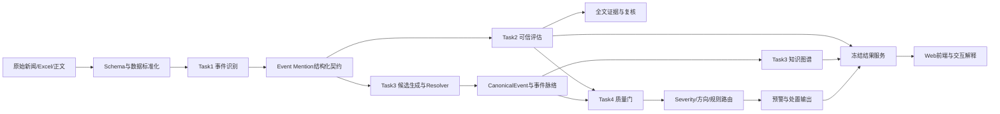

> 本报告随可运行交付包提供。下文所称项目目录对应本包 `source/financial_event_project/`；指标源文件位于 `runtime_data/financial_event_project/outputs/`。离线训练所需原始数据和模型权重未纳入本包，复现实验需另行准备。

# 面向上市公司的事件驱动智能识别、可信评估与脉络追踪系统技术报告

**文档版本：** v1.0  
**整理日期：** 2026-09-21  
**项目目录：** `/opt/data/private/JinRong/kechuang`  
**交付组成：** Task1 事件识别、Task2 可信评估、Task3 事件脉络与知识图谱、Task4 影响/风险路由，以及本地可交互前端展示平台。

## 摘要

本项目面向上市公司公开信息的事件监测场景，构建从新闻输入到事件识别、可信评估、事件归并、知识图谱、影响分析和预警路由的完整处理链路。系统将一篇新闻中的目标主体、事件类型、事件触发信息和证据位置整理成结构化事件，再把同一现实事件的多篇报道归并为 `CanonicalEvent`，在此基础上输出可信度、证据链、当前状态、影响方向和风险处置建议。

系统由离线数据处理与评估链路、冻结结果服务层和浏览器前端组成。离线链路负责数据标准化、模型推理、证据检索、人工/AI辅助评审和指标计算；`event-intelligence-frontend` 通过 Python 标准库服务读取冻结产物，以 REST 风格接口向前端提供总览、事件、可信评估、时间线、预警、知识图谱和任务链路数据。前端不在浏览器中重新训练或推理模型，重点承担结果解释、检索、交互和演示。

当前结果显示，Task1 事件匹配基线在 1271 条验证样本上达到 92.05% Accuracy、91.88% Macro-F1；Task2 的独立 500 条 AI 辅助评估中，系统 Accuracy 为 67.20%、Macro-F1 为 64.56%，证据结构完整率和 JSON 最终解析率均为 100%；Task3 官方 1799 条评测中，结构化事件有效准确率为 95.50%，B³ F1 为 84.26%，错误合并 3 条；Task4 独立 741 条可评样本的有序 Severity QWK 为 0.311，±1 级准确率为 97.30%。这些指标说明系统已经形成可运行的工程闭环，但 Task3 的候选召回、Task4 的高风险识别和事件方向判定仍是主要改进方向。

## 1. 问题理解

### 1.1 业务问题

金融市场中的一条新闻通常只描述事件的一个侧面。同一现实事件可能被多个来源重复报道，也可能随着时间出现确认、反转、升级或影响扩散。若系统直接以新闻条数作为事件条数，会产生重复预警；若只依赖单一来源或单一分类分数，又难以回答“这条信息是否可信”“它对应哪个现实事件”“当前影响有多大”以及“是否需要人工处置”等问题。

本项目将问题拆分为四个相互衔接的任务：

1. **Task1：事件识别。** 判断新闻是否触发某个主体/行业事件 Schema，并抽取目标、事件名称、触发词、证据片段、时间和论元。
2. **Task2：可信评估。** 综合来源、传播、结构质量、全文证据、支持/反证信号和复核结果，输出可信分、可信等级、证据链和核验状态。
3. **Task3：事件脉络与知识图谱。** 判断多篇新闻是否属于同一个现实事件，形成 `Event Mention → CanonicalEvent` 归并关系，保留成员报道、时间、状态变化和来源。
4. **Task4：影响与风险路由。** 对通过上游质量门的事件进行有序风险强度、影响方向和处置路由判断，输出 `alert / review / suppress / abstain / covered` 等结果。

### 1.2 输入与输出

输入主要包括：带标签新闻 Excel、无标签新闻、事件 Schema、新闻正文和元数据、来源信息、人工评审表，以及 Task3/Task4 官方 1799 条评测文件。

主要输出包括：

- 标准化新闻级 JSONL 和事件对 JSONL；
- 事件识别概率、阈值决策、目标与事件 Grounding 字段；
- 事件簇可信分、可信等级、证据句、反证句和核验状态；
- CanonicalEvent、成员报道、事件当前状态、事件线程和图谱节点/边；
- 影响等级、方向、质量门状态、证据溯源和风险路由；
- 前端总览、事件监测、可信评估、演化追踪、预警中心、知识图谱和任务链路页面。

### 1.3 设计目标

系统设计目标不是只追求单个分类指标，而是同时满足：

- **可追溯：** 每个结论都能回到新闻、证据句、来源和处理阶段；
- **可拒识：** 对证据不足、主体不明、事件不确定或输入不满足契约的样本保留 review/abstain 路由；
- **可复现：** 使用固定数据版本、冻结产物、阈值、哈希和评估协议；
- **可解释：** 前端展示事件、证据、分数、时间线、关系和处理链路；
- **可部署：** 演示服务只依赖 Python 标准库，能够直接读取已有冻结结果。

## 2. 技术路线

系统采用“数据契约 → 事件识别 → 可信评估 → 事件归并 → 影响路由 → 解释展示”的流水线。



### 2.1 数据标准化

首先将不同来源的 Excel/JSONL 数据映射到统一 Schema。核心字段包括 `article_id`、`title`、`publish_time`、`source`、`content`、`target_type`、`target_code`、`target_name`、`event_name`、`emotion`、`impact_analysis` 和 `duplication_id`。标准化阶段执行必需字段、非空、唯一性、代码类型和值域检查，并对公司代码、行业代码、时间、重复关系和未匹配 Schema 单独生成审计报告。

### 2.2 Task1 事件识别

Task1 将新闻和候选事件 Schema 组成事件对输入，由中文 MacBERT Cross-Encoder 完成二分类。输入包含目标主体、候选事件名称、事件定义、新闻标题和正文，不将标签、负样本类型等字段输入模型，避免标签泄漏。训练数据按事件组切分，避免同一现实事件或同一重复新闻跨训练集与验证集传播。

模型输出概率后进行阈值搜索，当前规范阈值为 0.38，以验证集 Macro-F1 为选择指标。系统还实现了重复新闻标签传播、负样本构造、同实体困难负样本实验和 CE/Pairwise 对比实验；经对比，当前正式基线仍优于直接加入困难负样本或纯 Pairwise 后处理方案。

### 2.3 Task2 可信评估

Task2 先用规则、来源、传播、文本质量和事件一致性特征形成基础可信分，再接入全文证据。全文模块从原始新闻正文中抽取支持句、反证句和官方来源信号；严格盲审模块只向复核模型提供主张和证据，不提供当前可信分、等级或规则结论。

困难样本按条件进入 Cached DEA。检索层采用 SQLite FTS5 trigram、B-tree 元数据索引和进程内 LRU 缓存，DEA 负责候选排序、去重和证据可追溯校验。最终按照既定融合规则更新分数：

- `support`：`+12 × confidence`；
- `contradict`：`-35 × confidence`；
- `insufficient`：`-5 × confidence`；
- `failed`：隔离，不参与融合。

### 2.4 Task3 事件归并与知识图谱

Task3 解决的是“多篇新闻是否描述同一个现实事件”，而不是普通文本相似度聚类。系统先使用主体、事件族、时间、触发词、关键论元、对象、状态和来源等信息生成候选对，再由 Resolver v2 输出 `same_event`、`different_event` 或 `uncertain`。

通过 Structured Event Contract，系统对目标、事件、证据、时间、论元、来源和 Grounding 状态进行字段级校验。通过 Resolver 的事件对决策后，多条 Event Mention 被归并到 CanonicalEvent，形成事件成员、状态变化、时间顺序和来源关系。前端知识图谱以公司、事件、类型、技术、政策和风险节点及其边展示这些结果。

### 2.5 Task4 影响与风险路由

Task4 只处理通过上游质量门的事件，不重新修复 Task1/Task3 的目标、事件或证据错误。其处理顺序为：

1. 检查事件结构、目标、事件和证据 Grounding；
2. 应用有序 Severity 模型；
3. 合并可信度、事件当前状态和财务/规则信号；
4. 生成影响方向、严重程度、证据溯源和路由；
5. 根据质量门进入 `alert`、`review`、`suppress`、`abstain` 或 `covered`。

当前工程已经具备 Severity 和路由链路，但尚未完成白皮书意义上的完整五轴 Impact Score 人工 Gold 与同等级模型，报告中不将当前结果表述为完整五轴影响评分。

## 3. 系统架构

### 3.1 分层架构

| 层次 | 主要组件 | 责任 |
|---|---|---|
| 数据层 | `data/raw`、`data/processed`、`outputs`、`reports` | 保存原始新闻、标准化数据、模型输出和评估报告 |
| 离线处理层 | `financial_event_project/scripts`、`src` | 数据清洗、Schema 构建、模型训练/推理、证据检索、事件归并和评估 |
| 契约层 | Event Schema、Structured Event Contract、Task3/Task4 interface | 约束字段、状态、证据和路由含义 |
| 结果服务层 | `event-intelligence-frontend/api_server.py`、`workflow_store.py` | 静态文件服务、冻结结果装配、预警规则与确认状态持久化 |
| 前端展示层 | `index.html`、`app.js`、`api.js`、`charts.js`、CSS | 路由、页面渲染、筛选、抽屉、图谱、任务链路和响应式交互 |
| 测试层 | Python unittest、Node mock test、Playwright | 接口逻辑、Mock API、页面交互和异常路径验证 |

### 3.2 服务层工作方式

`api_server.py` 通过 `EVENT_INTELLIGENCE_PROJECT_ROOT` 找到 `financial_event_project`，读取冻结结果文件并装配为 `/api/v1` JSON。若未提供显式路径，服务会根据前端目录的相对位置寻找项目根目录。预警确认、规则和关注条件由 `workflow_store.py` 保存到 SQLite，不修改模型冻结产物。

前端通过 `js/api.js` 统一访问后端；`CONFIG.USE_MOCK=false` 时使用真实本地 API，设为 `true` 时使用 `js/mock-data.js` 离线演示。前端页面使用 Hash 路由，核心路由包括 `dashboard`、`events`、`credibility`、`timeline`、`alerts`、`graph` 和 `integration`。

### 3.3 数据流与状态边界

- 模型和离线脚本只负责生成冻结结果，不直接依赖浏览器状态；
- 前端只读取结果，不在浏览器中修改原始事件、可信评分和图谱数据源；
- 预警确认、规则和关注条件属于演示工作台状态，单独保存在 SQLite；
- 页面通过事件 ID 维持可信评估、演化追踪和预警之间的上下文一致性；
- 图谱节点详情中的可信度和风险字段只使用已有字段，缺失时显示“未提供”。

## 4. 核心算法

### 4.1 Schema 约束与数据质量

Schema 阶段通过必需字段、非空、唯一性、类型和值域规则阻断明显脏数据。重复新闻通过 `duplication_id` 和规范化文章关系进行标签传播，但传播结果保留来源和继承标记；无法可靠匹配的记录进入 unresolved 报告，不强行写入事件标签。

### 4.2 MacBERT 事件匹配

训练输入可以抽象为：

```text
[目标] 类型、名称、证券代码
[候选事件] 事件名称、事件定义
[新闻] 标题、正文
```

采用 `hfl/chinese-macbert-base`、二分类 Cross-Encoder、最长长度 512、6 个 epoch、学习率 `2e-5`、有效批量 16、FP16 和 Macro-F1 早停。正文采用头部 70% 与尾部 30% 的截断策略，尽量保留目标、事件定义、标题和结尾事实。

### 4.3 全文证据融合

全文证据模块将新闻正文转为可检索索引，从事件簇关联的文章中抽取证据句。支持、反证和证据不足分别进入不同的评分分支，复核模型只看主张与证据，避免把已有结论泄露给评审。Cached DEA 只在困难样本条件满足时触发，从而控制调用量和运行时间。

### 4.4 Resolver 与 CanonicalEvent

Resolver 的基本判断不是“文本是否相似”，而是“事实是否属于同一个现实事件”。特征和约束包括：主体是否一致、事件族是否一致、时间是否相容、触发词和关键论元是否一致、对象和状态变化是否相容、来源是否可以形成时间链。输出不确定时保留 `uncertain`，交由 review 路由，避免强行合并。

### 4.5 有序 Severity 与路由

Severity 使用有序标签而非无序类别，输出从低到高的风险强度。路由层把 Severity 与可信度、事件质量门、证据溯源和规则条件组合，先判断“是否有资格进入影响评分”，再决定是否报警。该设计把事件识别错误与影响评分错误隔离，避免 Task4 通过内部评分掩盖上游 Grounding 问题。

### 4.6 前端解释与交互

前端按事件 ID组织分析上下文，可信评估、时间线和预警页面围绕同一个事件展示。任务链路页面先选择事件，再按阶段查看结果；知识图谱支持节点点击、节点拖动、空白区域平移、缩放、关系查看和事件分析入口；预警中心支持规则阈值、确认处置和状态持久化。

## 5. 关键模块

| 模块 | 代码/产物 | 作用 |
|---|---|---|
| Schema 构建 | `financial_event_project/scripts/build_event_schema.py` | 构建并校验事件定义 |
| 标准化数据 | `scripts/build_labeled_dataset.py` | Excel/新闻转统一 JSONL 和事件对 |
| 重复标签增强 | `scripts/augment_duplicate_news.py` | 传播转载新闻标签并记录冲突 |
| 负样本构造 | `scripts/build_negative_pairs.py` | 构造可解释的负样本类型 |
| 训练/评估切分 | `scripts/split_train_validation.py` | 按事件组防止泄漏 |
| 事件匹配 | `src/...` 与 `outputs/event_match_baseline` | MacBERT 事件触发判断 |
| 可信评估 | `src/event_credibility` | 规则评分、全文证据和 Cached DEA |
| Resolver/KG | `outputs/task3_kg_v4_official1799_inference_v1` | 事件归并、状态和图谱 |
| 影响路由 | `outputs/task34_official1799_final_evaluation_v1` | Severity、方向和路由结果 |
| API 服务 | `event-intelligence-frontend/api_server.py` | 静态服务和冻结结果接口 |
| 状态存储 | `event-intelligence-frontend/workflow_store.py` | 预警确认、规则、关注条件 |
| 前端 | `event-intelligence-frontend/js/app.js` 等 | 监测、分析、图谱和演示交互 |

## 6. 实验设计

### 6.1 评估数据与协议

| 评估对象 | 样本/规模 | 主要用途 | 口径 |
|---|---:|---|---|
| Task1 事件匹配验证集 | 1271 | 阈值与二分类性能 | 阈值 0.38，Macro-F1 选择 |
| Task2 全文事件簇 | 2061 | 全文证据覆盖和分数变化 | 全量事件簇统计 |
| Task2 独立 AI 辅助集 | 500 | 六维可信标签与系统对比 | prediction freeze 后评估 |
| Task2 正式 DEA 运行 | 260 | 复核触发、检索和工程稳定性 | Cached DEA |
| Task3 官方测试 | 1799 | 结构、Grounding、归并评估 | 冻结 Gold 和最终协议 |
| Task4 独立可评样本 | 741 | Severity、方向和高风险识别 | 独立评测 |
| Task4 全链路 | 1799 | 质量门和路由漏斗 | Task1→Task3→Task4 |

### 6.2 对比实验

Task1 比较阈值 0.5 与验证集最优阈值 0.38，并比较困难负样本、Targetwise 和 CE+Pairwise 方案。Task2 比较 Baseline、Round1 和 Cached DEA，记录准确率、Macro-F1、证据覆盖、调用次数、耗时和失败率。Task3 采用官方 1799 条冻结样本和双份标注文件对齐后评估 pairwise 与 B³。Task4 分别报告独立 Severity 性能和全链路路由性能，避免把上游覆盖不足混入模型本身的独立准确率。

### 6.3 复现原则

- 使用固定输入文件和 SHA256；
- 所有正式预测在评估前冻结；
- 训练、调参和测试数据边界明确；
- 指标来自统一评估模块和最终 Gold；
- Task3/Task4 历史根因 Benchmark 不混入官方 1799 正式指标。

## 7. 效果评估

### 7.1 Task1 事件识别

在 1271 条验证样本上，阈值 0.38 的结果为：

| 指标 | 结果 |
|---|---:|
| Accuracy | 92.05% |
| Precision | 94.79% |
| Recall | 86.90% |
| Positive F1 | 90.67% |
| Macro-F1 | 91.88% |
| ROC-AUC | 96.54% |
| FP / FN | 27 / 74 |

阈值从 0.5 调整到 0.38 后，Recall 和 Macro-F1 提升，说明该任务在当前数据分布下需要更积极地保留候选事件。

### 7.2 Task2 可信评估

全文增强覆盖 2061 个事件簇，其中 2061 个有全文证据句，1903 个有正文支撑信号，474 个有矛盾/反转信号。全文增强平均分为 40.22，分数范围为 0–100。

独立 50 条受控评估中，Cached DEA Accuracy 为 74.00%、fixed Macro-F1 为 0.6327，优于 Baseline 的 68.00% Accuracy 和 0.6005 Macro-F1。由于该集合由 AI 辅助并经用户确认，且 `contradict` 仅 1 条，不用于统计显著性结论。

独立 500 条 AI 辅助评估中，系统 Accuracy 为 67.20%、Macro-F1 为 64.56%、Coverage 为 100%，Brier Score 为 0.44417。六维结果 JSON 最终解析率、完整率、非法证据 ID、非法状态和非法强度检查均达到质量门要求。

正式 260 条 Cached DEA 运行中，完成 260 条、触发 DEA 155 条、失败 0 条；检索平均耗时约 0.239 秒，P95 约 0.757 秒。该结果支持当前检索缓存和 checkpoint 设计的工程可用性，但不等价于线上生产 SLA。

### 7.3 Task3 事件脉络与知识图谱

官方 1799 条评测结果：

| 指标 | 结果 |
|---|---:|
| Structured Event Valid Accuracy | 95.50% |
| Target Grounding Accuracy | 89.72% |
| Event Grounding Accuracy | 80.27% |
| Evidence Grounding Accuracy | 100.00% |
| Pairwise Precision / Recall / F1 | 98.17% / 58.97% / 73.68% |
| B³ Precision / Recall / F1 | 99.93% / 72.85% / 84.26% |
| False Merge | 3 |
| Split Error | 112 |
| Uncertain Rate | 1.42% |

结果表明错误合并已经较少，但候选召回仍限制了事件归并覆盖。`gold_same_pairs_in_candidate_set / gold_same_pairs_all_universe` 为 273 / 1253，说明后续应优先改进候选生成，而不是单纯继续强化 Resolver 后处理。

### 7.4 Task4 影响与风险路由

独立 741 条可评样本的 Severity 结果为：

| 指标 | 结果 |
|---|---:|
| QWK | 0.3111 |
| MAE | 0.6235 |
| Spearman | 0.2553 |
| ±1 级准确率 | 97.30% |
| 高风险 Precision / Recall / F1 | 48.15% / 72.22% / 57.78% |
| Direction Macro-F1 | 20.35% |

1799 条全链路路由中，covered 613 条、review 949 条、suppress 141 条、abstain 81 条、alert 15 条；整体覆盖率为 34.91%，review 比例为 52.75%，alert 比例为 0.83%。在 741 条 eligible 样本中，覆盖 483 条，eligible coverage recall 为 65.18%。

这些结果说明系统具备保守路由和拒识能力，但方向判断、覆盖率和高风险精度仍不够稳定。前端预警页面适合用于结果查看和人工处置，不应将当前 alert 数量理解为完整市场风险召回率。

## 8. 不足分析与改进方向

### 8.1 候选召回限制了 Task3 覆盖

Task3 的 Pairwise Precision 很高，但 Recall 明显低于 Precision，且候选集只覆盖部分 Gold 同事件对。改进方向是扩展候选阻断键、引入更稳健的时间/状态/论元召回、针对同主体不同事件建立更精细的候选分层，并为候选漏召回单独建立审计集。

### 8.2 Task4 方向与高风险识别仍弱

Direction Macro-F1 只有 20.35%，高风险 Precision 为 48.15%，说明高风险样本数量少、标签不平衡且事件方向具有上下文依赖。需要补充更多人工 Severity/Direction Gold，建立分层校准和成本敏感评估，并把“证据不足”与“方向不确定”区分开。

### 8.3 当前影响评分不是完整五轴模型

当前 Task4 已具备 Severity、可信度、规则和路由，但 Scope、Urgency、Novelty、Evolution 等维度还没有同规模、同质量人工 Gold 和完整模型。因此产品中的影响等级应标明当前评分口径，避免将其描述为已经完成的完整白皮书五轴 Impact Score。

### 8.4 AI 辅助标注的统计边界

Task2 的独立 500 条评估和部分复核结果含 AI 辅助与用户确认，不能直接替代大规模独立人工 Gold。后续应建立盲审、双人标注、裁决和一致性报告，并保持预测文件在标注前冻结。

### 8.5 演示服务与生产服务的边界

当前 `api_server.py` 适合本地演示和成果包预览，使用 Python 标准库、共享 SQLite 状态和冻结结果文件。它没有生产级用户隔离、权限管理、任务队列、监控、限流和多副本部署能力。若用于生产，需要将结果服务、状态存储、身份认证和异步任务执行拆分。

### 8.6 前端交互限制

当前前端已经具备事件上下文、证据核对、图谱交互、任务链路和预警确认，但前端展示依赖后端冻结数据的完整性。未来可以增加真实任务进度、接口耗时、数据版本、证据引用跳转和审计日志，使演示状态与实际生产任务状态进一步区分。

## 9. 结论

项目已经形成从新闻到结构化事件、可信评估、事件归并、知识图谱和风险路由的完整工程闭环，并通过冻结产物、字段契约、证据溯源、质量门和多层测试提高了可复现性。当前最有价值的继续投入方向是扩大 Task3 候选召回、补充 Task4 方向/高风险 Gold、完善五轴影响评分以及将本地演示服务升级为具备权限、异步任务和审计能力的生产服务。

## 10. 主要参考产物

- `financial_event_project/reports/canonical_baseline_metrics.json`
- `financial_event_project/reports/TASK1_FINAL_OPTIMIZED_TECHNICAL_REPORT.md`
- `financial_event_project/reports/TASK2_FINAL_TECHNICAL_REPORT.md`
- `financial_event_project/reports/event_credibility/task2_fulltext_experiment_summary.md`
- `financial_event_project/outputs/task34_official1799_final_evaluation_v1/final_metrics.json`
- `financial_event_project/outputs/task34_official1799_final_evaluation_v1/task34_machine_state.json`
- `event-intelligence-frontend/api_server.py`
- `event-intelligence-frontend/js/app.js`
- `event-intelligence-frontend/tests/test_workflow.py`
- `event-intelligence-frontend/tests/workflow.spec.cjs`
